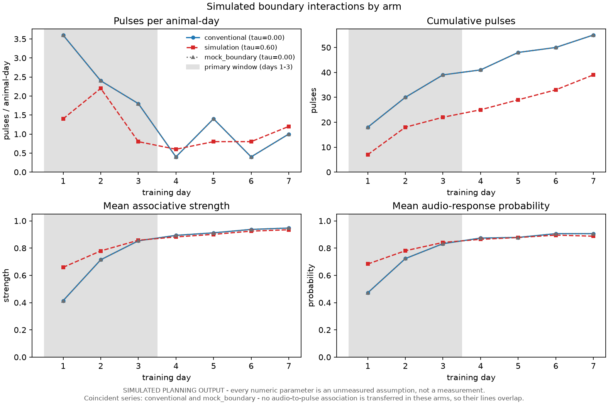
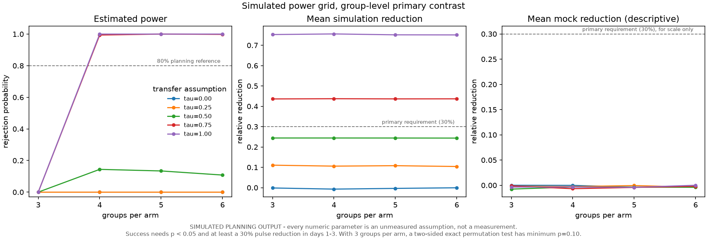
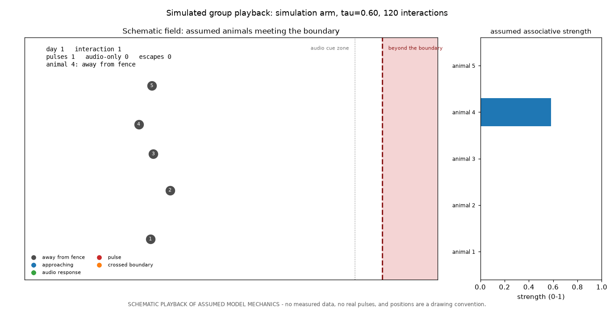

# vf-sim-training

Planning code for the thesis **"Training Cattle in a Virtual Environment Before
Real Virtual Fencing"**. It is an intentionally simple, reproducible
agent-based model of cattle encountering a virtual-fence boundary.

The simulation asks a planning question: under explicit, unmeasured assumptions,
would transfer from a pre-training environment reduce pulse exposure during the
first three days of real virtual-fence training? It **does not establish animal
learning, welfare, or transfer effectiveness**.

## What is included

- Rescorla-Wagner learning of the audio-to-pulse association.
- Audio-only response probability that increases with associative strength.
- A group social-facilitation term based on recent responders.
- Three study arms: `conventional`, `simulation`, and `mock_boundary`.
- Group-level Monte Carlo power calculations, including the preregistered
  planning target of a 30% lower pulse rate over the first three days.
- Generic, schema-inspecting local data loaders. They report actual files and
  headers; they never assume source column names.
- Optional figure output for the simulation and the power grid. matplotlib is
  not required for the text output.

Every numeric model parameter is an **ASSUMPTION**, not a measurement. Candidate
datasets are for model calibration and workflow development only; none can
substitute for the proposed transfer experiment.

## Quick start

```powershell
python -m venv .venv
.\.venv\Scripts\Activate.ps1
python -m pip install -r requirements.txt
python -m pip install -e .
pytest
python scripts/run_simulation.py --arm simulation --tau 0.60 --seed 20261010
python scripts/run_power_analysis.py --replications 500 --seed 20261010
```

Use `--help` with either script for options. Results printed by these scripts
are simulated outputs conditional on their assumptions, not experimental
findings.

## Figures (optional)

The text output never needs a plotting library. Install the optional extra to
write figures:

```powershell
python -m pip install -e ".[plots]"
python scripts/run_simulation.py --arm simulation --tau 0.60 --plot --compare-arms
python scripts/run_power_analysis.py --replications 500 --plot --format svg --dpi 300
```

`--plot` adds a figure to the same text output. `--compare-arms` overlays the
three arms at one transfer assumption, `--outdir` chooses the directory
(default `results/`), and `--format` (`png`, `svg`, `pdf`) and `--dpi` set the
file type and raster resolution. Add `--show` to hold the figure open in a
window after it is written; the command returns when you close the window.
Without matplotlib, both scripts still print their usual text and fail with an
install hint rather than a traceback.

The simulation figure shows pulses per animal-day, cumulative pulses, mean
associative strength, and mean audio-response probability by training day, with
days 1-3 shaded as the preregistered primary window. The power figure shows
estimated power, the mean simulation reduction, and the descriptive
mock-boundary reduction against groups per arm, one line per transfer
assumption. Every figure repeats the caution that its numbers are simulated
assumptions, so a figure cannot be mistaken for a result once it leaves this
repository.

Generated examples, from the commands above:



*Pulses per animal-day, cumulative pulses, mean associative strength and mean
response probability by training day, with the days 1-3 primary window shaded.
The pre-trained arm starts above the conventional arm on strength and stays
below it on pulses.*



*Estimated power, mean simulation reduction and the descriptive mock-boundary
reduction against groups per arm, one line per transfer assumption.*

## Watch it play (animation)

`scripts/show_simulation.py` plays one simulated group meeting the boundary as
an animation. Each animal rests away from the fence, approaches it, and either
responds to the audio cue or takes a pulse; the bars beside the field show its
assumed associative strength, so learning is visible as pulses become rarer.



```powershell
python scripts/show_simulation.py                            # window: simulation arm, tau 0.60, 3 days
python scripts/show_simulation.py --arm conventional --loop  # sham contrast, repeating until closed
python scripts/show_simulation.py --gif                      # results\playback_*.gif for slides
python scripts/show_simulation.py --still --still-at 0.8     # one PNG frame for a figure
```

`--steps` sets how many frames are drawn per boundary interaction, `--interval`
the milliseconds per frame, and `--max-frames` caps the length of a GIF. The
scene is a drawing convention: positions, the field and the fence are schematic,
and an escape is drawn as a single crossing because the model does not remove
escaped animals from later interactions. The event history being drawn is the
model's own. Exporting a GIF redraws every frame, so allow roughly a minute for
a few hundred frames.

## Project layout

```text
src/vf_training/       simulation, metrics, power, optional figures, data inspection
scripts/               command-line entry points
tests/                 deterministic unit tests
docs/                  proposal, design, ethics, sources, search protocol
data/raw/              locally obtained data only (ignored by Git)
data/processed/        derived local data only (ignored by Git)
results/               local generated outputs (ignored by Git)
```

See [the proposal](docs/thesis_proposal.md), [study design](docs/study_design.md),
[dataset verification](docs/datasets.md), and
[ethics and preregistration](docs/ethics_and_prereg.md) before treating this as
a study protocol.

