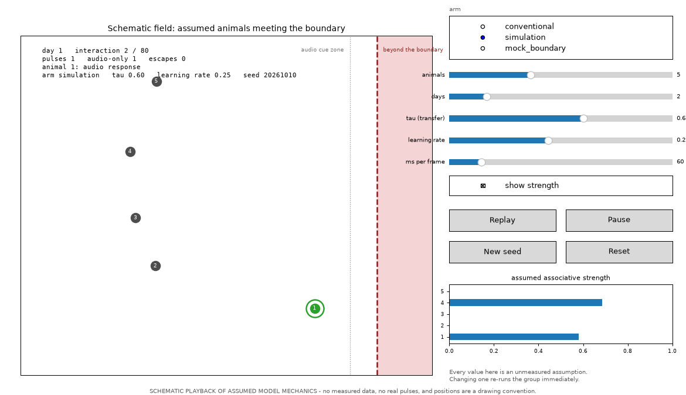
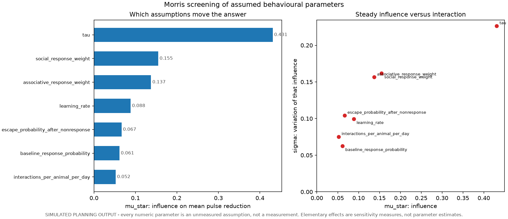

# vf-sim-training

[](https://github.com/flyapex/Virtual-Fence/actions/workflows/tests.yml)
[](LICENSE)
[](pyproject.toml)
[](https://github.com/astral-sh/ruff)

Planning code for the thesis **"Training Cattle in a Virtual Environment Before
Real Virtual Fencing"**: an intentionally simple, reproducible agent-based model
of cattle encountering a virtual-fence boundary.

The model asks a planning question. Under explicit, unmeasured assumptions,
would transfer from a pre-training environment reduce pulse exposure during the
first three days of real virtual-fence training, and how many groups would such
a study need? It **does not establish animal learning, welfare, or transfer
effectiveness**, and it contains no measured animal data.

## What is included

- Rescorla-Wagner learning of the audio-to-pulse association, with a
  group social-facilitation term based on recent responders.
- Three study arms: `conventional`, `simulation`, and `mock_boundary`.
- Group-level Monte Carlo power calculations for the planned 30% lower pulse
  rate over days 1-3.
- Optional day-by-day figures, a power-grid figure, and an animated playback of
  one group. matplotlib is not required for any text output.
- Schema-inspecting local data loaders that report actual files and headers and
  never assume source column names.

Every numeric model parameter is an **ASSUMPTION**, not a measurement. Candidate
datasets are for calibration and workflow development only; none can substitute
for the proposed transfer experiment.

## Install

```powershell
git clone https://github.com/flyapex/Virtual-Fence.git
cd Virtual-Fence
python -m venv .venv
.\.venv\Scripts\python.exe -m pip install -e ".[plots,dev]"
```

`.[plots,dev]` adds matplotlib, the test runner, coverage, ruff and mypy. For the
text output alone, plain `pip install -e .` is enough. The same commands work on
macOS and Linux with `python3 -m venv .venv` and `source .venv/bin/activate`.

## Quick start

Installing the package provides four commands, which also run from `scripts/`:

| Command | Script | What it does |
| --- | --- | --- |
| `vf-simulate` | `scripts/run_simulation.py` | One group, one arm: metrics, optionally a figure |
| `vf-power` | `scripts/run_power_analysis.py` | Power grid over groups per arm and transfer assumptions |
| `vf-play` | `scripts/show_simulation.py` | Animated playback of one group, or `--live` to tune it as it runs |
| `vf-sensitivity` | `scripts/run_sensitivity_analysis.py` | Morris screening: which assumptions actually move the answer |
| `vf-calibrate` | `scripts/run_calibration.py` | Fit the behavioural parameters to real audio/pulse records |
| `vf-inspect` | `scripts/inspect_datasets.py` | Candidate dataset metadata and local file inspection |

```powershell
vf-simulate --arm simulation --tau 0.60 --seed 20261010
vf-power --replications 500 --seed 20261010
vf-simulate --help          # every option, for each command
```

Everything printed is a simulated output conditional on its assumptions, not an
experimental finding. Runs are deterministic: the same arguments and seed give
the same numbers on any machine.

## Figures (optional)

`--plot` adds a figure to the same text output. `--outdir` chooses the directory
(default `results/`), `--format` (`png`, `svg`, `pdf`) and `--dpi` set the file
type and raster resolution, and `--show` holds the figure open in a window (the
command returns when you close it). `--compare-arms` exists on `vf-simulate`
only, where it overlays the three arms at one transfer assumption.

```powershell
vf-simulate --arm simulation --tau 0.60 --plot --compare-arms --show
vf-power --replications 500 --plot --format svg --dpi 300
```

The committed examples are produced by:

```powershell
vf-simulate --arm simulation --tau 0.60 --plot --compare-arms --outdir docs/figures
vf-power --replications 500 --plot --outdir docs/figures
vf-play --gif --outdir docs/figures
vf-play --still --outdir docs/figures
```

The output names carry their parameters; the committed copies are renamed to the
names this README embeds (`arms_day_by_day.png`, `power_grid.png`, `playback.gif`,
`playback_still.png`). See [`CONTRIBUTING.md`](CONTRIBUTING.md) for the exact
`Move-Item` lines.

Without matplotlib the commands still print their usual text and fail with an
install hint rather than a traceback.


*Pulses per animal-day, cumulative pulses, mean associative strength and mean
response probability by training day, with the planned days 1-3 primary window
shaded. The pre-trained arm starts above the conventional arm on strength and
stays below it on pulses. Conventional and mock-boundary lines coincide, because
the model currently transfers no association in either arm.*


*Power, mean simulation reduction and the mock-boundary reduction against groups
per arm, one line per transfer assumption. The mock panel is a null by
construction, and at 3 groups per arm no effect of any size can reject.*

## Watch it play (animation)

`vf-play` plays one simulated group meeting the boundary. Each animal rests away
from the fence, approaches it, and either responds to the audio cue or takes a
pulse; the bars beside the field show its assumed associative strength, so
learning is visible as pulses become rarer.


*One frame is also committed as `docs/figures/playback_still.png`.*

```powershell
vf-play                                    # window: simulation arm, tau 0.60, 3 days
vf-play --arm mock_boundary --loop         # the sham arm, repeating until closed
vf-play --gif                              # results\playback_*.gif for slides
vf-play --still --still-at 0.8             # one PNG frame for a figure
```

`--steps` sets how many frames are drawn per boundary interaction, `--interval`
the milliseconds per frame, and `--max-frames` caps the length of a GIF. The
scene is a drawing convention: positions, the field and the fence are schematic,
and an escape is drawn as a single crossing because the model does not remove
escaped animals from later interactions. The event history being drawn is the
model's own. Exporting a GIF redraws every frame, so allow roughly a minute for
a few hundred frames.

## Tune it live

`vf-play --live` opens one field panel with the controls beside it. Nothing on
that panel is measured: every slider sets an assumption, and changing one
re-simulates the group and restarts the playback, so you can watch what an
assumption does instead of reading about it.



```powershell
vf-play --live                          # the whole control panel
vf-play --live --animals 8 --days 5     # start from a bigger, longer group
vf-play --live --strength               # start with the strength bars showing
```

| Control | Sets |
| --- | --- |
| arm | `conventional`, `simulation` or `mock_boundary` |
| animals | group size, 1 to 12 |
| days | training days to play, 1 to 7 |
| tau (transfer) | how much pre-trained association transfers, simulation arm only |
| learning rate | the Rescorla-Wagner alpha |
| ms per frame | playback speed, 20 to 300 |
| show strength | toggles the associative-strength bars |
| Replay / Pause | restart from the first frame, or hold the current one |
| New seed / Reset | re-run with the next seed, or return to the defaults |

The seed is shown on the panel, so a run you liked can be reproduced exactly with
`vf-play --seed <that number>`. Without a display the command explains that it
cannot open a window and points at `--gif` and `--still` instead of failing
silently.

## Which assumptions actually matter

```powershell
vf-sensitivity --plot          # 2 seconds at the defaults
```

`vf-sensitivity` runs a [Morris screening](https://doi.org/10.1021/ie00019a005)
over the behavioural assumptions, using the [ADEMP](https://onlinelibrary.wiley.com/doi/full/10.1002%2Fsim.8086)
view of a simulation study. It reports each assumption's influence on the planned
pulse reduction (`mu_star`) and how much that influence varies along different
paths (`sigma`), which is where non-linearity or interaction shows up.



At the defaults, the ranking is unambiguous:

| Assumption | Influence (`mu_star`) |
| --- | --- |
| `tau` (transfer of pre-training) | **0.431** |
| `social_response_weight` | 0.155 |
| `associative_response_weight` | 0.137 |
| `learning_rate` | 0.088 |
| `escape_probability_after_nonresponse` | 0.067 |
| `baseline_response_probability` | 0.061 |
| `interactions_per_animal_per_day` | 0.052 |

The planning answer is dominated by the one parameter nobody has measured — how
much pre-trained association transfers to the real collar. Calibration and
elicitation effort belongs there first; the remaining assumptions move the answer
by a fifth as much or less. Elementary effects are sensitivity measures, not
causal claims and not parameter estimates.

## Calibrating against real records

Everything above runs on assumptions. `vf-calibrate` is how a measured dataset
replaces some of them.

```powershell
vf-calibrate --self-test     # verifies the pipeline on model-generated data, no download needed
vf-calibrate --data data/raw # fits to real animal-day audio/pulse records
```

The loader maps a documented USDA column set (`No. Audios`, `No. Pulses`,
`Neckband ID`, a day or timestamp column) onto the quantities this model
produces. It searches every CSV under the path, reports which columns it matched,
and refuses to guess when it cannot find them. Records are summed per animal-day;
ISO timestamps are numbered from the earliest date present.

The fit is a grid search over `learning_rate`, `baseline_response_probability`,
`associative_response_weight` and `social_response_weight`, minimising a
scale-free distance between the observed and simulated per-day profiles. Two
parameters are **measured rather than fitted** — encounters per animal-day and the
escape rate — because the records state them directly.

The report includes a marginal profile per parameter, so non-identifiability is
visible instead of hidden behind a best value. In the self-test the day-level
profile is reproduced closely while four different parameter sets fit almost
equally well: the data constrain the behaviour, not the individual constants.
That is a finding to report, not a bug to fix.

## Known limitations

These are properties of the current code, not of the study design. Read them
before quoting any number from this repository.

- **Power here is not power for the analysis the protocol describes.** `vf-power`
  estimates the probability that a two-sided group-label permutation test
  rejects *and* the observed reduction reaches 30%. The protocol's primary
  analysis is a mixed count model with a group random effect, which is **not
  implemented**. Treat these numbers as power for the permutation contrast only.
- **The design floor is arithmetic.** With g groups per arm the smallest
  attainable two-sided p is 2/C(2g,g): 0.10 at 3 groups per arm, where no effect
  of any size can reject. The table marks those rows.
- **The mock-boundary arm has no mechanism of its own.** It is simulated exactly
  like the conventional arm, so its reported reduction is a null by construction
  and carries no information beyond conventional.
- **The social-facilitation window saturates.** With the default window of 10
  interactions in a 5-animal group, the social fraction is 1.0 for most of a run,
  so `social_response_weight` acts closer to a constant offset than to dynamic
  facilitation.
- **The sensitivity analysis covers the behavioural assumptions**, but only via
  one-at-a-time Morris screening on the mean reduction; it does not screen the
  trial-design parameters, and it is not a variance decomposition. See
  `vf-sensitivity --help` for the effort controls.
- **No calibration workflow.** The candidate datasets are documented and can be
  inspected with `vf-inspect`, but nothing yet fits model parameters to them.
- **Nothing is preregistered yet.** The 30% target, the days 1-3 window and the
  time-to-criterion default (80% for two consecutive days, first day of that run)
  are planning conventions to be frozen in a timestamped preregistration before
  data collection.

## Project layout

```text
src/vf_training/       model, metrics, power, figures, animation, CLI
scripts/               thin wrappers around the installed commands
tests/                 deterministic unit tests (90% branch coverage)
docs/                  proposal, design, ethics, datasets, search protocol
docs/figures/          generated figures embedded in this README
data/raw/              locally obtained data only (ignored by Git)
data/processed/        derived local data only (ignored by Git)
results/               local generated outputs (ignored by Git)
```

## Citing

Citation metadata is in [`CITATION.cff`](CITATION.cff); GitHub renders a "Cite
this repository" button from it. The author name there is still a placeholder.

## Contributing

See [`CONTRIBUTING.md`](CONTRIBUTING.md) for the setup, the checks that must pass
(`pytest`, `ruff check`, `ruff format --check`, `mypy`), and the two rules that
come first: no number becomes a measurement by accident, and reproducibility is a
feature. Changes are listed in [`CHANGELOG.md`](CHANGELOG.md).

Read [the proposal](docs/thesis_proposal.md), [study design](docs/study_design.md),
[dataset verification](docs/datasets.md), and
[ethics and preregistration](docs/ethics_and_prereg.md) before treating any of
this as a study protocol.
